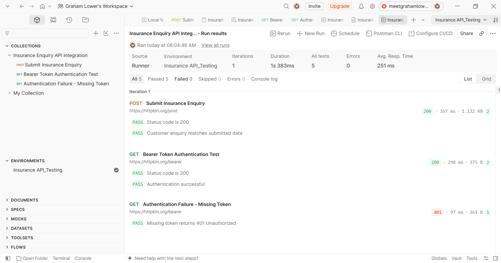

# Insurance Enquiry API Integration

## Quick Start Guide

New to this API integration? Follow the [Quick Start Guide](QUICKSTART.md) to make your first API request, test authentication and troubleshoot common errors.

## API Troubleshooting Guide

Experiencing integration issues? Follow the [API Troubleshooting Guide](TROUBLESHOOTING.md) to diagnose common API errors, authentication failures, rate limits and server errors.

## Project Overview

A Python-based demonstration of how an insurance enquiry
can be validated and submitted to an external REST API.

This project demonstrates practical API integration,
customer data validation, error handling, automated
testing, dependency management and version control.

It uses the public HTTPBin demonstration API rather than
a live insurance platform.

## Objectives

- Demonstrate REST API integration.
- Validate customer information before submission.
- Send structured JSON data using HTTP POST.
- Process API responses and HTTP status codes.
- Handle common integration errors.
- Protect API credentials using environment variables.
- Verify functionality through automated testing.
- Provide clear technical documentation.

## Project Structure

```text
API-Advocate/
├── insurance_integration/
│   ├── api_client.py
│   ├── customer.py
│   ├── main.py
│   └── test_customer.py
├── first_api.py
├── requirements.txt
├── .gitignore
└── README.md
```

## Architecture

The integration follows a simple workflow:

1. Receive customer enquiry information.
2. Validate the required customer fields.
3. Reject invalid or incomplete information.
4. Submit valid information to the demonstration API.
5. Process the HTTP response.
6. Report success or failure.

### Component Responsibilities

| File | Responsibility |
|---|---|
| main.py | Controls the integration workflow |
| customer.py | Validates customer information |
| api_client.py | Handles API communication |
| test_customer.py | Runs automated validation tests |
| first_api.py | Contains introductory API exercises |
| requirements.txt | Records Python dependencies |
| .gitignore | Excludes sensitive and unnecessary files |

## Prerequisites

- Python 3
- Git
- Internet connection
- A terminal or command prompt

The project was developed using Python 3.15.2
and Visual Studio Code on Windows.

## Installation

Create a Python virtual environment:

```cmd
python -m venv .venv
```

Activate the virtual environment on Windows
using Command Prompt:

```cmd
.venv\Scripts\activate.bat
```

Install the required dependencies:

```cmd
python -m pip install -r requirements.txt
```

## Running the Integration

From the project root directory, run:

```cmd
python insurance_integration/main.py
```

## API Endpoint

- Method: POST
- Endpoint: https://httpbin.org/post
- Content type: application/json
- Request timeout: 10 seconds

HTTPBin returns the submitted information for
demonstration and testing purposes. It does not
create a real insurance enquiry or policy.

## Example Request

```json
{
    "name": "John Smith",
    "email": "john@example.com",
    "telephone": "07123456789",
    "enquiry_type": "Motor Insurance"
}
```

All customer information used in this project
is fictional demonstration data.

## Successful Response

A successful request returns HTTP status 200.

The application displays:

```text
Validation: Customer information is valid.

Enquiry submitted successfully!
HTTP status: 200
```

The returned JSON customer information is also
displayed in the terminal.

## Customer Data Validation

The application checks:

- Required customer fields are present.
- Required fields contain non-empty strings.
- Email addresses follow a basic expected format.
- Telephone numbers contain between 10 and 15 digits.

These checks do not verify that an email address
or telephone number actually exists.

Invalid information is rejected before an API
request is made.

Example:

```text
Validation: Invalid email address.

Enquiry was not submitted.
```

## Automated Testing

The project uses Python's built-in unittest module.

Run the automated tests using:

```cmd
python insurance_integration/test_customer.py
```

### Test Coverage

| Test | Expected Behaviour |
|---|---|
| Valid customer | Accepted |
| Missing email | Rejected |
| Invalid email | Rejected |
| Invalid telephone | Rejected |
| Empty customer name | Rejected |

Initial test results: 5 out of 5 tests passed.

The validation tests run locally without
contacting the external API.

## Error Handling

The integration handles common request failures,
including:

- Connection errors.
- Request timeouts.
- Unsuccessful HTTP responses.
- Other request-related exceptions.

Errors are reported rather than allowing
request failures to terminate the application
without explanation.

## Security

The project uses a .gitignore file to exclude:

- .env files containing environment variables.
- The Python virtual environment.
- Automatically generated Python cache files.

API credentials should never be hardcoded into
production applications or committed to Git.

Bearer token headers and environment variables
have been explored in the introductory API
exercises.

Authentication is not currently required by the
demonstration insurance enquiry endpoint.

## Troubleshooting

### ModuleNotFoundError

Check that the virtual environment is active
and the required dependencies are installed.

### ImportError

Check that the required function exists in the
correct Python file and that changes are saved.

### File Not Found - Errno 2

Check that the terminal is open in the
API-Advocate project directory.

### HTTP 400

Check the request format and submitted data.

### HTTP 401

For authenticated APIs, check the credentials
and authentication requirements.

### HTTP 403

Check whether the authenticated user has the
required permissions.

### HTTP 404

Check the API endpoint URL.

### HTTP 429

Check the API rate limits and retry guidance.

### HTTP 500

Investigate a possible server-side failure.

### Request Timeout

Check internet connectivity and API availability.

## Future Development

- Authenticated API integration.
- OAuth 2.0 authentication.
- Webhook handling.
- API testing with Postman.
- Automated API client tests.
- Structured application logging.
- Configurable API endpoints.
- Customer-facing integration documentation.
- Continuous integration using GitHub Actions.

## About the Project

Developed by Graham Lower as a practical
API Advocate portfolio project.

The project combines hands-on API integration
learning with 27 years of customer-facing,
commercial and operational motor trade experience,
progressing from sales to General Manager.

The objective is to develop the technical skills
required to bridge the gap between customers,
integration partners and software engineering teams.
## Automated API Testing Results

The Postman Collection Runner successfully executed
three API requests with five automated tests.

- Total tests: 5
- Passed: 5
- Failed: 0
- Errors: 0
- Success rate: 100%



## Disclaimer

This is an independent educational demonstration.
It is not affiliated with SchemeServe or any
insurance provider and does not process real
insurance policies or customer information.