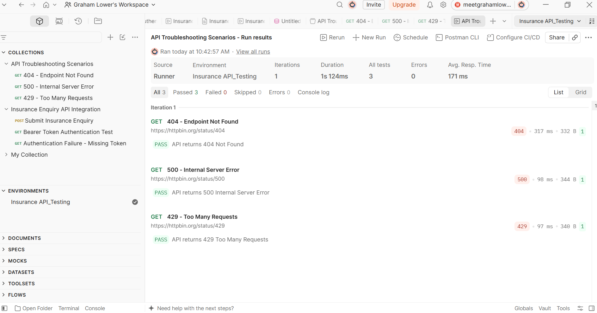

# API Troubleshooting Guide

## Insurance Enquiry API Integration

## 1. Introduction

This guide helps customers and third-party integration partners identify, understand and resolve common problems when working with REST APIs.

It provides practical troubleshooting steps, explanations of HTTP status codes and guidance on when to escalate an issue to an engineering team.

This project uses httpbin, a public HTTP testing service, to demonstrate API behaviour in a controlled learning environment. It is not connected to a live insurance platform.

## 2. Initial Troubleshooting Checklist

Before escalating an API issue, check the following:

- Is the API endpoint correct?
- Is the correct HTTP method being used?
- Are authentication credentials present and valid?
- Are the required request headers included?
- Is the request body correctly formatted?
- Are all mandatory fields present?
- Is the internet connection working?
- Is the correct API environment selected?
- What HTTP status code has been returned?
- Does the response body contain additional error information?

These checks can help identify the cause of many common integration problems.

## 3. HTTP Status Code Reference

| Status Code | Meaning | Recommended Action |
|---|---|---|
| 200 | OK | Confirm the response contains the expected data |
| 201 | Created | Confirm the new resource has been created |
| 400 | Bad Request | Review request data and formatting |
| 401 | Unauthorised | Check authentication credentials |
| 403 | Forbidden | Check permissions and access rights |
| 404 | Not Found | Verify the endpoint and resource identifier |
| 429 | Too Many Requests | Review rate limits and retry policies |
| 500 | Internal Server Error | Investigate and escalate if necessary |
| 503 | Service Unavailable | Check service availability |

## 4. Common Troubleshooting Scenarios

### 4.1 — 400 Bad Request

**What it means**

The server cannot process the request because of a perceived client-side error.

**Possible causes**

- Invalid JSON formatting.
- Missing mandatory fields.
- Incorrect data types.
- Invalid request parameters.

**Recommended actions**

1. Review the API documentation.
2. Check the required fields.
3. Validate the JSON request body.
4. Review the response for validation messages.
5. Correct the request before submitting it again.

### 4.2 — 401 Unauthorised

**What it means**

The request does not contain valid authentication credentials.

**Possible causes**

- Missing authentication token.
- Invalid or expired token.
- Incorrect authentication method.
- Incorrect Authorization header.

**Recommended actions**

1. Confirm the required authentication method.
2. Check that the token is present.
3. Verify the Authorization header format.
4. Obtain a new token if required.
5. Retest the request.

Never include authentication tokens in screenshots, support tickets or public repositories.

### 4.3 — 403 Forbidden

**What it means**

The server understands the request but refuses to authorise it.

**Possible causes**

- Insufficient permissions.
- Restricted resources.
- Incorrect account access level.
- Security policies preventing access.

**Recommended actions**

1. Confirm the required permissions.
2. Check the account or integration access level.
3. Contact the relevant administrator if access is required.
4. Escalate if the expected permissions are already in place.

### 4.4 — 404 Not Found

**What it means**

The server cannot find the requested resource, or is unwilling to disclose its existence.

**Possible causes**

- Incorrect API endpoint.
- Typographical error in the URL.
- Incorrect resource identifier.
- Deprecated API version.

**Recommended actions**

1. Compare the URL with the API documentation.
2. Check the API version.
3. Verify the resource identifier.
4. Confirm the correct environment is selected.
5. Retest the corrected request.

**Demonstration endpoint**

https://httpbin.org/status/404

**Expected response:** HTTP 404.

**Automated Postman test:** Passed.

### 4.5 — 429 Too Many Requests

**What it means**

The client has exceeded a request limit imposed by the API.

This is commonly referred to as rate limiting.

**Possible causes**

- Excessive request frequency.
- Repeated automated requests.
- Insufficient delay between requests.
- Account or integration rate limits.

**Recommended actions**

1. Review the API rate limit documentation.
2. Reduce request frequency.
3. Check for a Retry-After response header.
4. Implement controlled retries with exponential backoff.
5. Contact the API provider if additional capacity is required.

Avoid continuously retrying failed requests, as this may worsen the problem.

**Demonstration endpoint**

https://httpbin.org/status/429

**Expected response:** HTTP 429.

**Automated Postman test:** Passed.

### 4.6 — 500 Internal Server Error

**What it means**

The server encountered an unexpected condition that prevented it from completing the request.

**Possible causes**

- Application errors.
- Database problems.
- Unexpected server-side conditions.
- Failure of a dependent service.

**Recommended actions**

1. Confirm that the request follows the API documentation.
2. Record the response and time of occurrence.
3. Check the provider's service status, where available.
4. Determine whether the problem is reproducible.
5. Escalate persistent errors to the engineering team.

Do not automatically retry requests that create or modify records unless the API supports safe retry mechanisms, such as idempotency keys.

**Demonstration endpoint**

https://httpbin.org/status/500

**Expected response:** HTTP 500.

**Automated Postman test:** Passed.

## 5. Timeouts and Connectivity Issues

Not every API failure produces an HTTP status code.

A request may fail before a response is received.

**Possible causes**

- Internet connectivity problems.
- DNS resolution failures.
- Firewall restrictions.
- TLS certificate problems.
- Slow server responses.
- Service outages.

**Recommended actions**

1. Confirm internet connectivity.
2. Verify the API hostname.
3. Check firewall and proxy settings.
4. Review the configured request timeout.
5. Check the API provider's service status.
6. Attempt a controlled retry where safe.
7. Escalate persistent connectivity problems.

A timeout does not necessarily mean that the server failed to process the request.

## 6. Troubleshooting Workflow

1. Understand the customer's reported problem.
2. Collect the relevant technical information.
3. Reproduce the issue using Postman.
4. Inspect the request and response.
5. Identify the likely cause.
6. Recommend corrective action.
7. Retest the integration.
8. Escalate unresolved issues to engineering.
9. Communicate progress to the customer.
10. Document the resolution.

## 7. Engineering Escalation Template

When an issue cannot be resolved, provide engineering with a clear and reproducible report.

### Issue Summary

- Customer or integration reference:
- Date and time, including time zone:
- Environment:
- API endpoint:
- HTTP method:
- HTTP status code:
- Request or correlation ID, if available:

### Problem Description

Describe what the customer was attempting to achieve and what happened instead.

### Expected Behaviour

Describe the expected API response or outcome.

### Actual Behaviour

Describe the response received, including relevant error messages.

### Steps to Reproduce

1. 
2. 
3. 

### Troubleshooting Already Completed

Record the checks performed and their results.

### Business Impact

- Number of customers affected:
- Business processes affected:
- Availability of a workaround:
- Urgency:

### Supporting Evidence

Include relevant screenshots, sanitised request and response data, and test results.

Remove credentials, personal information and other sensitive data before sharing.

## 8. Customer Communication

Effective API troubleshooting requires clear communication as well as technical knowledge.

When communicating with customers:

- Acknowledge the reported problem.
- Explain technical findings in accessible language.
- Avoid unnecessary technical jargon.
- Provide clear and actionable next steps.
- Avoid assigning blame before establishing the cause.
- Set realistic expectations.
- Provide progress updates.
- Confirm the resolution with the customer.

## 9. Automated Troubleshooting Test Results

The API Troubleshooting Scenarios collection was executed using the Postman Collection Runner.

| Test Scenario | Expected Status | Actual Status | Result |
|---|---|---|---|
| Endpoint Not Found | 404 | 404 | PASS |
| Internal Server Error | 500 | 500 | PASS |
| Too Many Requests | 429 | 429 | PASS |

**Test date:** 26 November 2026.

**Total tests:** 3.

**Passed:** 3.

**Failed:** 0.

**Success rate:** 100%.

These tests intentionally request specific HTTP error responses.

A passing test confirms that the expected status code was received.

The tests do not establish that a production insurance platform correctly handles or recovers from these errors.

The remaining troubleshooting scenarios in this guide are provided as general technical guidance.

## 10. Security and Data Protection

When troubleshooting API integrations:

- Never expose API keys or authentication tokens.
- Use environment variables or secure credential storage.
- Never commit sensitive credentials to GitHub.
- Use fictional customer data in public demonstrations.
- Remove personal information from diagnostic evidence.
- Follow applicable data protection requirements.
- Use authorised test environments wherever possible.

## 11. Conclusion

Successful API troubleshooting combines technical investigation, structured problem-solving and effective customer communication.

The objective is not simply to identify an error, but to help customers and integration partners achieve a reliable integration.

## Related Documentation

- [Project Overview](README.md)
- [Customer Quick Start Guide](QUICKSTART.md)
